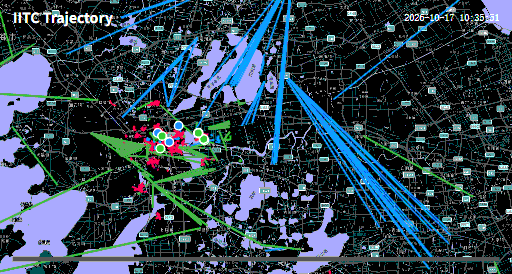

# IITC Trajectory Replay Toolkit

<p align="center">
  
</p>

This toolkit turns exported IITC COMM activity into an interactive map replay and a compact, shareable GIF. It consists of three IITC userscripts:

| Component | Purpose |
| --- | --- |
| [COMM Exporter](https://github.com/Xelminoe/IITCLogReplay/blob/main/iitc-plugin-comm-exporter.user.js) | Downloads public COMM messages for a selected time and map range. |
| [Snapshot Exporter](<IITC plugin- Snapshot Exporter-1.0.0.txt>) | Saves the portals, links, and fields currently loaded by IITC to a local JSON snapshot. |
| [Trajectory Loader](<IITC plugin- Trajectory Loader-1.9.019.txt>) | Loads COMM logs and an optional snapshot, reconstructs activity, plays it on the map, and exports GIFs. |

The tools run in the browser. COMM and snapshot JSON files, player-color settings, and generated GIFs are not sent to a separate service by this toolkit.

## Requirements and installation

- IITC-CE running on `https://intel.ingress.com/`.
- A userscript manager or another supported IITC plugin installation method.
- A modern browser with Canvas, Blob downloads, and `async`/`await` support.

Install each script as a separate userscript:

1. Install [COMM Exporter from GitHub](https://raw.githubusercontent.com/Xelminoe/IITCLogReplay/main/iitc-plugin-comm-exporter.user.js).
2. Install `IITC plugin- Snapshot Exporter-1.0.0.txt` from this directory. If the userscript manager rejects `.txt`, copy its contents into a new userscript or rename a copy to `.user.js`.
3. Install `IITC plugin- Trajectory Loader-1.9.019.txt` in the same way.
4. Reload Intel. The IITC toolbox should contain **COMM Export**, **Export snapshot**, and **Trajectory Loader**.

The Trajectory Loader filename is historical; the userscript metadata inside the file is the authoritative version.

## Recommended workflow

1. Export the relevant COMM interval.
2. Optionally capture a map snapshot covering the operation area.
3. Load the COMM JSON files in Trajectory Loader.
4. Load the snapshot if one is available.
5. Select players, assign colors, and press **Render**.
6. Review the replay and activity timeline.
7. Select one or more GIF time windows if idle periods should be skipped.
8. Configure the GIF and press **Export GIF**.

## 1. Export COMM logs

Open **COMM Export** from the IITC toolbox.

### Time and pagination

- **Start Time** and **End Time** use the browser's local time.
- **Max Pages** limits the number of requests. The default is 100.
- A larger area or a busy interval may require more pages. If the export stops with `Reached max pages limit`, increase this value and export again.

### Geographic range

By default, the exporter uses the current IITC map bounds.

To export a square centered on a portal:

1. Select the portal on the map before opening COMM Exporter.
2. Open **COMM Export**.
3. Enable **Use selected portal bounds**.
4. Choose a range from 100 m through 51.2 km.

The portal-range option is unavailable if no loaded portal was selected when the dialog opened.

Press **Start Export**. The plugin requests public COMM pages directly from Intel, removes system narrowcasts, parses the messages through IITC, and downloads a file named like:

```text
comm_logs_20261014210200_20261014220200.json
```

The file contains the requested range, geographic bounds, message count, and parsed messages. It may be combined with other COMM exports in Trajectory Loader.

## 2. Export an optional map snapshot

A snapshot is useful when links existed during the operation but their creation messages are absent from the COMM export.

Before exporting:

1. Pan and zoom to the relevant area.
2. Wait for IITC to finish loading portal, link, and field data.
3. If the area is larger than one view, visit the necessary tiles so the required entities are loaded into IITC.
4. Press **Export snapshot** in the IITC toolbox.

The downloaded file is named like:

```text
iitc-snapshot-20261014-220341.json
```

It contains:

- capture time and local timezone information;
- map center, zoom, and bounds;
- every portal, link, and field currently present in IITC's loaded collections;
- entity data, geometry, faction information, and available timestamps.

This is a snapshot of currently loaded IITC data, not a request for every entity in the world. Missing map tiles produce missing snapshot entities.

Trajectory Loader currently uses snapshot portals to resolve link endpoints and snapshot links to supplement link lifecycles. Snapshot fields are preserved in the JSON but are not replayed or drawn.

## 3. Load data in Trajectory Loader

Open **Trajectory Loader** from the toolbox.

### COMM data

1. Under **Data**, choose one or more COMM JSON files.
2. Press **Load File**.
3. Check the summary for the number of files, supported events, players, and the actual time range.
4. Expand **Load log** only when detailed parsing information or an error is needed.

Multiple files are merged, deduplicated, and sorted by event time. The loader recognizes these spatial actions:

- portal capture;
- resonator deployment;
- link creation;
- resonator destruction;
- link destruction.

Unsupported COMM messages remain irrelevant to the replay.

### Link snapshot

1. Under **Link snapshot (optional)**, choose a Snapshot Exporter JSON file.
2. Press **Load Snapshot**.
3. Read the summary to confirm how many links were accepted, skipped, deduplicated, or merged.

The snapshot can be loaded before or after rendering. If a replay is already active, loading or removing it triggers a redraw.

## 4. Select players and colors

The player list is ordered by supported activity count.

- Check every player to include in the replay or GIF.
- Use the color input beside a player to assign a persistent custom color.
- **Full trail (single player)** draws the complete inferred trail when exactly one player is selected.
- **Short trails (multiple players)** draws recent completed trail segments during a multi-player replay.

Player selection and custom colors are stored in browser local storage.

Default faction colors are:

| Faction | Color |
| --- | --- |
| Resistance | `#1E90FF` |
| Enlightened | `#32CD32` |
| Machina | `#FF1744` |
| Neutral | `#9E9E9E` |

A custom player color affects that player's trail, position marker, event effects, and links created by that player. A destroyed link is not recolored as the destroying player: it keeps its creator override when known, otherwise its faction color.

Press **Render** after changing the selected players. Rendering also rebuilds the activity timeline and clears any previously selected GIF windows.

## 5. Use map playback

The playback controls are:

- **Render**: builds the selected replay on the IITC map.
- **Clear**: removes replay layers and activity-window selections.
- **Play** / **Pause**: controls virtual time.
- **Speed**: selects 1×, 10×, 25×, 50×, 100×, 200×, or 400× playback. The default is 50× and the selection is remembered.
- **Timeline slider**: seeks to an event time. The label shows the event counter and current timestamp.

Map playback shows event halos, destruction indicators, active-link lifecycles, and optional player trails. Playback speed affects only the interactive map; GIF timing is controlled separately by the GIF settings.

## 6. Select GIF time windows

After pressing **Render**, a colored activity heatmap appears below the event counter. Each selected player receives one lane in that player's color. Brighter regions contain more supported activity.

The narrow rail below the heatmap controls GIF windows:

- Drag an empty part of the rail to add a window.
- Drag a selected window's left or right edge to resize it.
- Click a window to select it.
- Press **Remove** to delete the selected window.
- Press **Clear all** to return to a full-range export.

Windows shorter than one second are discarded. Overlapping windows, or windows separated by no more than one second, are merged automatically.

If no window is selected, the GIF covers the complete selected-player time range. With multiple windows, frames are allocated in proportion to each window's source duration and played in chronological order. The progress bar at the bottom of the GIF still maps the full real-time range, so it visibly jumps when an omitted interval is skipped.

## 7. Export a GIF

Arrange the IITC map before exporting. The current on-screen map viewport is frozen as the export boundary, its aspect ratio is preserved, and content outside that boundary is clipped.

### Export controls

| Control | Values | Notes |
| --- | --- | --- |
| **Size** | 1080p, 720 px, 640 px, 512 px | This is the maximum edge. With a 16:9 viewport, 1080p produces 1920×1080. |
| **FPS** | 8, 6, 4 | Higher values improve motion but increase size and encoding time. |
| **Duration** | 10 s, 15 s, 20 s | Playback duration before the final hold. |
| **End hold** | 1–5 s | Holds the last frame; default 3 s. |
| **Map** | On/off | Freezes the currently visible base-map tiles. |
| **Grid** | On/off | Adds a screen-space reference grid. |
| **Portals** | On/off | Adds currently loaded, visible IITC portals as neutral markers without names. |
| **Scale** | On/off | Adds a metric scale derived from the current map viewport. |

The four background options are independent. Their fixed background order is:

```text
Scale > Portals > Grid > Map
```

The GIF intentionally does not draw player trajectory lines. It shows active links, recent event pulses, inferred player-position markers, the legend, timestamp, and the continuous real-time progress bar.

Press **Export GIF** and leave the IITC tab open while the textual status reports tile capture, encoding attempts, frame progress, and the final file information. **Cancel** stops an active export.

The encoder targets approximately 9.5 MB. If an attempt is too large, it automatically retries with a smaller dimension, lower frame rate, and compact palette. The final resolution can therefore be lower than the selected preset. The completion status reports the actual dimensions and file size and warns if the lowest attempt still exceeds the target.

Map tiles must be readable by the browser's canvas security model. If the Map layer cannot be captured, wait for the current tiles to finish loading and retry, or export without Map.

## How position inference works

COMM is action evidence, not GPS data. The position shown by the toolkit is an estimate shared by map trails and GIF markers.

The model uses capture, deploy, link, and resonator-destruction events. Link destruction does not provide a player-position observation. For a link event, the first portal in the COMM record is treated as the operation portal.

The default calculation is:

1. Build a time-weighted estimate using events within one minute before and after each action.
2. Give capture, deploy, and link events weight `1.0`; give resonator destruction weight `0.15`.
3. Constrain capture, deploy, and link estimates to 40 m from the operation portal.
4. Give resonator destruction a conservative 208 m outer bound: 40 m portal-to-resonator radius plus 168 m weapon range.
5. Within that outer bound, apply a nonlinear preference for shorter weapon distance to approximate severe damage falloff. This is an inference prior, not an exact Ingress damage formula.
6. Use only a weak adjacent-distance preference. No turn-angle, curvature, or acceleration penalty is applied, so sharp turns and immediate reversals remain possible.
7. Interpolate linearly between inferred event nodes on the real timeline.

A player marker is hidden before that player's first supported event and remains at the last inferred position after the final event.

### Advanced position tuning

The defaults are defined in `RENDER.config` inside the Trajectory Loader userscript. Common adjustments are:

```javascript
trajSmoothWindowMs: 1 * 60 * 1000,
trajWeightsByType: {
  capture: 1.0,
  deploy: 1.0,
  link: 1.0,
  destroy_reso: 0.15
},
interactionRadiusByType: {
  capture: 40,
  deploy: 40,
  link: 40
},
destroyPortalRadiusM: 40,
destroyWeaponRangeM: 168,
destroyFalloffStrength: 0.35,
trajContinuityWeight: 0.03
```

`trajSmoothWindowMs` is the radius on each side of an event, so three minutes means a six-minute total observation window. Larger values usually make the route less noisy but can blend separate actions. `trajContinuityWeight` should remain small: it prefers shorter adjacent movement but intentionally does not penalize sharp turns. Reload IITC after editing the userscript. Because map replay and GIF export share one position model, every change applies to both.

## How link lifecycles are reconstructed

- A COMM link-creation event starts a link lifecycle.
- A matching destruction event ends it.
- A destruction without a known creation implies that the link existed from the replay boundary until its destruction.
- A link still open at the end remains visible through the end of the replay.
- Snapshot links supplement links missing from COMM.

Snapshot entity timestamps are not treated as reliable creation times. IITC can update an existing link's entity timestamp when related field or tile data changes. A snapshot-only link is therefore treated as initial state and starts at the replay boundary; explicit COMM events can still split or close its lifecycle.

Snapshot-only links are included as environmental context even when their creators are not selected. COMM-derived links are included when a selected player created or destroyed them.

## Limitations

- The replay is an inference from public COMM, not a record of exact player movement.
- Missing COMM messages can make link birth or death times unknowable.
- A snapshot proves that an entity was present when captured but cannot, by itself, establish its true creation time.
- Snapshot fields are exported but not rendered by Trajectory Loader.
- The GIF Portals layer uses portals currently loaded in IITC at export time; loading a snapshot JSON does not repopulate IITC's live portal collection.
- Very long gaps between player events are still represented by linear interpolation.
- A frozen Map background depends on readable map tiles and may be affected by browser cross-origin restrictions.
- The size target is best effort. A complex 1080p export may remain above 9.5 MB even after automatic retries.

## Troubleshooting

### No players appear after loading

- Confirm that the file is the JSON produced by COMM Exporter.
- Expand **Load log** and inspect parsing errors.
- Check that the selected time and geographic range contain supported action messages.

### COMM export ends too early

- Increase **Max Pages**.
- Reduce the map area or split a long interval into multiple exports.
- Load all resulting files together; Trajectory Loader will merge and deduplicate them.

### Expected environmental links are missing

- Confirm that the links were loaded in IITC before the snapshot was exported.
- Load the snapshot and inspect its accepted/skipped link counts.
- Remember that a snapshot from another area or time cannot supply unseen links.

### Activity heatmap or GIF window rail is missing

- Select at least one player and press **Render**.
- Re-render after changing the player selection. This intentionally clears old GIF windows.

### GIF is too large or slow to encode

- Choose 720 px or lower.
- Reduce FPS or duration.
- Select only active time windows.
- Disable Map when the base map is unnecessary.

### Map background is blank or export fails during tile capture

- Keep the intended area visible and wait for all tiles to load.
- Retry without panning or zooming during export.
- Disable **Map**; Grid, Portals, and Scale can still be used independently.

